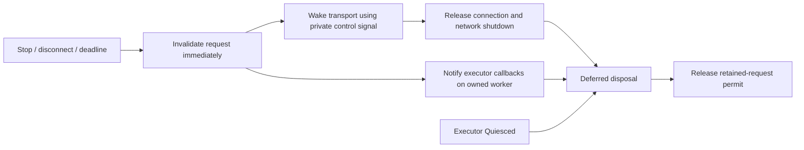

# Bridge execution and waiting model

Written before the held-callback correction, against `b334385`, following the author's independent review. The deadline P1 is closed; a new P2 shows that safety alone did not establish progress. This model guides the correction and its tests; it is not independent acceptance or live Revit evidence.

## Facts that must remain separate

| Fact | Owner and meaning | Does not imply |
|---|---|---|
| Cancellation requested | RequestLifetime atomically makes the request inactive; original budget remains authoritative | Registered callbacks have started or finished |
| Network released | Endpoint worker has completed its I/O, closed its connection and returned its slot | Executor or cancellation callbacks have finished |
| Executor finished | DispatchTicket.Quiesced says no executor can use Context again | Cancellation callbacks have finished |
| Callbacks finished | The lifetime's notification worker has returned from cancellation, including error reporting | Network/executor has finished |
| Lifetime disposed | All owners have released their uses; registrations and sources disposed; retention permit released | Every earlier operation succeeded |

There is deliberately no dependency from network release to callback completion. Physical disposal depends on both, plus executor quiescence. Cancellation cannot interrupt a callback that never returns; bounded retention and explicit Busy responses are the response to that condition.

## Why the existing paths fail

| Origin at b334385 | Execution path and locks | Waiting dependency that must be removed |
|---|---|---|
| Endpoint stop | Calling thread holds endpoint gate; stopping.Cancel invokes lifetime.CancelOwned, which runs borrowed callbacks synchronously | StopAsync cannot even return its task until the callback returns |
| Peer disconnect or extra bytes | Monitor continuation invokes disconnected.Cancel, then lifetime.CancelOwned and borrowed callbacks | Handle finally awaits the monitor; Serve cannot replace its slot |
| Request deadline | Owned delay continuation invokes lifetime.CancelOwned | Network can progress in the existing test because this origin already runs separately; that test did not prove the other paths |
| Upstream/owner token in a standalone lifetime | Token initiator, possibly its timer thread, invokes CancelOwned synchronously | Error containment is present, but progress still depends on callback return |
| Callback notification token | Transport close/wait callbacks and arbitrary executor callbacks share a token | Callback ordering can delay transport wakeup even if cancellation is moved to another task |

## Corrected execution contract

1. **Immediate invalidation is a state transition, not callback execution.** Context.ThrowIfInactive checks the same budget and authoritative cancellation state. Expose IsCancellationRequested for polling. The public Cancellation token remains cooperative executor notification; its notification may lag the immediate state transition. net48 cannot atomically mark a standard CTS canceled without invoking its callbacks. Do not pretend a background Cancel preserves synchronous token notification.
2. **A private transport signal is never lent to executor code.** Endpoint response waiting/pipe close, client connect/pipe close and provider binding wait use this signal. Its registrations contain only bridge-owned wakeup/close operations and asynchronous completion sources. No Revit read, executor callback or diagnostic consumer belongs on it.
3. **One notification worker per canceled lifetime.** After marking inactive and signaling transport, schedule at most one owned background thread that invokes the borrowed token's Cancel, contains exceptions and records/reports them. Repeated and concurrent origins do not create more workers. No endpoint/lifetime gate is held while borrowed callbacks execute. Using a dedicated worker avoids held callbacks occupying the pool used by network continuations. No global exception handler, forced thread abort or new request budget.
4. **Bound before admission, not after cancellation.** All PipeEndpoint instances sharing this runtime/AppDomain share eight retained-request permits. Acquire a permit before constructing/submitting an admitted lifetime. Retain it through network completion, executor Quiesced, callback completion and physical disposal. At capacity, validated requests receive correlated retryable Busy without dispatch, queued notification work or a new lifetime. Network connections remain bounded separately at eight per endpoint and continue to accept/reject requests. Restarting an endpoint does not reset retained capacity. Standalone lifetime users must bound their own admissions; the later MCP tool layer must retain that obligation.
5. **StopAsync publishes its shared stop task under the endpoint gate, then releases the gate before signaling or draining.** Stop may await network workers/I/O and attempt owned-descriptor cleanup. It must not await callback notification, executor Quiesced or lifetime disposal. Error reporting is a snapshot of known errors; a later callback error is recorded locally and remains observable by a later Stop. Descriptor cleanup retries retain prior errors.
6. **Disconnect monitor owns only network observation and immediate signaling.** It must return after signaling, even if a borrowed callback stays held. Handle may await this monitor after closing its pipe because the monitor cannot execute borrowed callbacks. Registration disposal on this path must likewise only wait for bounded bridge-owned signaling, never borrowed notification work.
7. **Retirement owns the physical wait.** After network cleanup, deferred retirement waits for executor Quiesced, the owned deadline operation, notification completion and origin-registration release; then disposes sources and releases the permit. A held callback or executor keeps its permit. Disposal failures remain observed/reported and cannot silently return an unsafe permit. Release is idempotent.

Submit is a trusted, nonblocking queue-admission handoff, not executor execution; the future dispatcher must preserve that distinction. Diagnostic sinks must enqueue or return promptly; arbitrary blocked diagnostic sinks are outside this cancellation-progress guarantee. Registering on an already-canceled public token can synchronously invoke code on the registering executor's thread: that work belongs to executor Quiesced, never the transport path. The Revit API reader remains confined to the later ExternalEvent executor.

## Allowed waits and locks

| Participant | May wait for | Must not wait for / run inline |
|---|---|---|
| Stop caller | Brief endpoint state lock to publish/reuse task | Network drain, borrowed callbacks, executor, retirement |
| Stop task | Network workers, owned-descriptor cleanup attempt | Executor Quiesced, notification worker, retained permits |
| Pipe worker | Bounded framing/I/O; response or private cancellation; short disconnect monitor | Borrowed callbacks or physical retirement |
| Cancellation origin | Brief lifetime state lock; bridge-owned control signaling; worker start | Notification completion or executor |
| Notification worker | Its registered callbacks and local failure reporting | No endpoint/lifetime gate held during callbacks |
| Retired lifetime | Network done, Quiesced, deadline worker, notification worker, bounded origin-registration release | No UI thread and no endpoint gate held while waiting |
| Capacity counter | Atomic permit acquire/release | No waiting queue; full capacity rejects promptly |

## Tests derived from the model

Cross actual endpoint origins **stop, disconnect, deadline** with **held-return / held-throw** callbacks and **Quiesced-before / Quiesced-after-network-release**. In every case, hold the callback throughout the progress assertion: StopAsync returns its task promptly, repeated stop completes and descriptor disappears; disconnect/deadline recover all eight simultaneous connection slots. Observe immediate inactivity, unchanged deadline, suppressed late results, retained callback resources, error reporting after release and eventual disposal. Record what runs before release, not merely eventual success.

Saturate all eight retained permits with held callbacks, free their network connections, then prove eight connections still open, valid work returns Busy without dispatch, stop/restart cannot bypass the cap, and releasing callbacks restores service. Include a held callback on a client lifetime to challenge provider/connect/response cancellation separately. Keep earlier exception/peer-exit/strict-protocol regressions; update any test that incorrectly equates immediate invalidation with notification completion or demands future callback errors before Stop may finish.

API basis: Microsoft documents [synchronous Cancel callbacks and aggregated errors](https://learn.microsoft.com/en-us/dotnet/api/system.threading.cancellationtokensource.cancel?view=net-10.0), and distinguishes immediate state transition from asynchronous notification in modern [CancelAsync](https://learn.microsoft.com/en-us/dotnet/api/system.threading.cancellationtokensource.cancelasync?view=net-10.0). The split above is original application code shared with net48, not copied framework code or a new SDK dependency.
