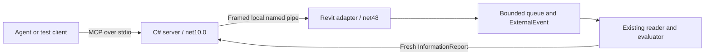

# Minimal Revit readiness MCP bridge: design specification

Date: 2026-10-20. Revision: 3. Status: **author-directed desktop compatibility amendment; amended runtime acceptance pending**. [Amendment and exact direction](2026-10-20-desktop-compatibility-amendment.md). R1 closure and written approval at `0ef8cdacb5112545a9aa6fbc59e0823df52f2e44` apply to revision 2; no new reviewer closure is claimed. Source baseline: `7d3ae71`; revision 1 review: `b56c0dc219e1269f5b90542004267a2d388f338d`. Current work branch: `feat/revit-mcp-bridge`.

This is architectural work under the superpowers brainstorming protocol. The author selected the minimal custom C# bridge after the [comparison](../../research/revit-mcp-bridge-comparison.md), then requested a written spec, implementation plan, and external review sessions. The [participant story](../../tutorials/06-direct-design-and-external-review.md) preserves those prompts. [R1 feedback and dispositions](../reviews/revit-mcp-bridge/2026-10-20-r1-feedback.md) record two major acceptance gaps and a minor timeout ambiguity, all addressed in this revision at the specification level. The [subsequent external follow-up and author decision](../reviews/revit-mcp-bridge/2026-10-20-r1-follow-up.md) close all three findings and approve revision 2. Revision 3 changes the protocol policy and A2/A8 through the linked amendment. The process architecture, lifetime/ownership requirements, sample expectations and other acceptance obligations remain. Earlier review closure does not establish these new runtime results.

## 1. Purpose and success

BIM professionals should be able to ask an agent to check required wall and ceiling type information in the intended open Revit sample, and receive the same evidence as our verified command. The teaching example must explain research, source provenance, specification, planning, review, implementation, and independent verification in two layers: a participant engagement story and a reproducible agent procedure.

The author's explicit constraints are the official C# MCP SDK **2.2.0**, retained support and tests for protocol **2026-07-28**, beginner-friendly Codex desktop and Claude Desktop with SDK-provided compatibility for their older exchanges, a minimal custom bridge, all three existing sample cases verified end to end, and an explicit account of whether older code is used. The agent proposes the detailed process, IPC, and lifecycle choices below; those choices are reviewable, not additional instructions attributed to the author.

Acceptance requires fresh calls through a real MCP client, the server, local IPC, Revit API execution, and the existing evaluator. A successful build, stored JSON read, or simulated Revit response cannot establish host acceptance. The three cases are three variants of the existing information check, not the larger demo's three BIM questions. Physical-condition checks and measured quantities remain separate increments.

## 2. Options and selected direction

| Approach | Benefit | Cost or constraint | Decision |
|---|---|---|---|
| Original narrow Revit adapter plus official C# MCP server | Reuses our tested BIM logic and installed .NET workflow; small explicit tool surface | We own IPC, lifecycle, identity, deadlines, and verification | Selected by the author after research; specified here |
| Adapt the inspected third-party Revit bridge | Existing routing, command catalog, and Revit integration | Requires MCP migration and changes to access, framing, scope, errors, and readiness integration | Retain as research precedent |
| Original Revit adapter plus official Python server | Viable SDK and approachable Python workflow | Adds another runtime/package workflow and still needs the C# Revit adapter | Retain as an alternative, outside this increment |

The dated [source evidence](../../research/evidence/mcp-version-observations-2026-10-20.json) supports this comparison. It does not prove our proposed runtime behavior.

## 3. Code provenance and dependency policy

| Material | Intended use | What we must be able to demonstrate |
|---|---|---|
| Official `ModelContextProtocol` 2.2.0 and resolved dependencies | Consume published NuGet packages, exact direct pin `[2.2.0]`, committed lockfile | Package graph, package hashes/notices, license and advisory review, locked restore, actual protocol trace |
| Official C# SDK documentation and examples | Learn supported registration, transport, result, and client APIs | Cite inspected release/commit; record any copied or adapted nontrivial snippet with its notice |
| Existing bridge using TypeScript `@modelcontextprotocol/sdk` 1.26.0 | Learning precedent only | No v1 package dependency, vendored source, copied handler, or copied transport in the implementation |
| RevitMCPSDK 2024 helper source | Learning precedent only | No runtime dependency or copied dispatch base class |
| Our `RequiredInformationReader`, core evaluator, and `InformationReport` | Reuse existing lab code | Source map and equivalence tests; preserve the existing rule and report semantics |
| New local connection, dispatch, context validation, and tool adapter | Original lab implementation | Reviewable source with tests and a final provenance audit |

**We are writing the Revit adapter, not implementing MCP from scratch.** The official SDK owns MCP parsing, transport behavior, protocol handling, discovery, and tool dispatch. Our private IPC contract is not a replacement MCP implementation. A protocol-test probe, if used, remains test code and is labeled accordingly.

The previous research inspected the C# release at commit `6fa3825973949a9c4f0cd8af344e15a8db09dc35`. The [release page](https://github.com/modelcontextprotocol/csharp-sdk/releases/tag/v2.2.0) and [dated specification](https://modelcontextprotocol.io/specification/2026-07-28) were reopened while drafting this spec. Refresh official release, registry, migration, and license evidence at adoption. If a newer release exists, record it and explain why the requested compatible pin is retained; do not silently change it. If the requested package cannot meet this contract, return the concrete discrepancy for a design decision.

SDK version, dated MCP revision, our private contract version, and JSON-RPC 2.0 are distinct. Do not label TypeScript SDK 1.26.0 as a C# SDK or MCP protocol version. Preserve actual SDK license/NOTICE material, including any retained earlier contribution terms; review the full resolved graph rather than inferring all licenses from the top-level package. The original lab's distribution license remains an owner decision before release.

## 4. Components and deployment boundary

| Component | Responsibility | Dependencies and source boundary |
|---|---|---|
| External server | Two tools, SDK protocol integration, IPC client, result/error mapping | New code in `projects/revit-readiness/src/mcp-server/`; net10.0 executable and official SDK. No Autodesk references or net48 core assembly loaded here |
| Wire contract | Plain request/response DTOs, operation names, version and bounds | Proposed `src/bridge-contract/` under that project; dependency-free code shared across net48/net10.0. Serialization stays in each runtime adapter |
| Revit bridge | Start/stop, session discovery, framed pipe server, queue, ExternalEvent, context validation | New focused files in existing `src/revit-addin/`; Revit 2024/net48 and Windows APIs; explicit project compile items |
| BIM computation | Read intended live document; evaluate declared requirements | Existing [reader](../../../projects/revit-readiness/src/revit-addin/RequiredInformationReader.cs), [checklist](../../../projects/revit-readiness/src/readiness-core/Checklist.cs), [evaluator](../../../projects/revit-readiness/src/readiness-core/TypeInformation.cs), [report](../../../projects/revit-readiness/src/readiness-core/InformationReport.cs) |
| Existing manual command | JSON/text/Excel output and user dialog | Existing command and isolated ClosedXML exporter; preserve their behavior |

Use the already recorded Revit 2024 build `24.3.60.12` and .NET SDK `10.0.204` for initial acceptance. The external server needs its matching .NET runtime; document its install/publish prerequisite separately from Revit's .NET Framework 4.8. Other host versions are unverified.

The MCP route calls the reader, not `RequiredInformationCommand.Execute()`. The server carries the report as JSON without reimplementing its evaluation or loading `System.Web.Extensions`. Preserve the report's member names and meanings across serialization. Infrastructure may write session descriptors and bounded diagnostics; the readiness tool itself creates no JSON, text, or Excel export. Evidence files are written by the verification client separately.

Bridge installation is explicit and per-user, with Revit closed. Extend the known lab installation rather than create conflicting copies of the add-in/core. Keep new MCP runtime packages in the external server directory. Retain installer identity checks, file hash inventory, and existing optional-fixture core synchronization. Do not enable fixture editing, redistribute Autodesk binaries, alter Revit configuration, or register a global agent-client configuration silently. The implementation plan will specify exact scripts, manifests, and rollback commands.

## 5. Tool contract and document binding

Expose exactly these tools; no arbitrary command, code, path, model-opening, editing, or export tool is included.

| Tool | Arguments | Successful structured result |
|---|---|---|
| `revit_get_readiness_context` | Empty object | Contract version, request/session identity, selected Revit process/build, active saved project identity/path, checklist ID/path/SHA-256, declared scope, opaque context token, expiry |
| `revit_check_required_type_information` | Required `contextToken` string; no other arguments | Contract version, request/session identity, checklist SHA-256, and complete fresh `InformationReport` under `report` |

Declare read-only intent using SDK tool annotations and reject unknown arguments. Annotations do not enforce read-only behavior. A finding is a successful observation: a report with missing information is not an execution error. Incomplete coverage remains an explicit report state, never a readiness pass. A tool failure has `isError=true` and structured `code`, `message`, `requestId`, and `retryable`; protocol-level malformed requests are handled by the SDK. Cancellation follows SDK semantics and cannot return a late success.

The trusted Revit side derives the `.checklist.json` sidecar from the active saved project using the existing convention. No caller controls that path. Validate the existing checklist schema and project/file/level/phase identities. Capture its bounded bytes once, hash and deserialize those same bytes; at execution reread bounded bytes, compare the hash and parse that same snapshot to avoid using a different checklist after validation.

An opaque random token is a server-side context reference, not an authorization credential. Bind it to the bridge session, open-document lifetime, `ProjectInformation.UniqueId`, canonical full project path, checklist ID/path/hash, and a five-minute expiry. Keep at most 32 live contexts per Revit bridge; purge expired records and return a capacity error if still full. Never silently evict an unexpired context. These are proposed operational bounds, not measured performance claims.

Both tools execute document access in valid Revit API context. Before reading, validate that the same document is currently active and that the session, document lifetime, path, and checklist still match. A copied project can share project UniqueId; that ID alone is insufficient. Closing/reopening a document, Save As, changed checklist bytes, restart, expiry, or a different active document invalidates the check. An active-document mismatch does not switch the model on the user's behalf. Obtain a new context after resolving it. A context does not freeze model contents: edits to values in the same still-open document are read fresh, with report timestamp and modified-state evidence.

## 6. Host lifecycle, IPC, and limits

The user starts the bridge through a named Revit command. Create the ExternalEvent there in valid API context; an application lifecycle hook owns shutdown cleanup. A stop command cancels pending work, closes connections, disposes the event in valid context, invalidates tokens, and removes only its own session descriptor. Startup registration alone does not begin listening. Repeated start is idempotent; restart gets a new session identity. The [Autodesk ExternalEvent guide](https://help.autodesk.com/cloudhelp/2024/ENU/Revit-API/files/Revit_API_Developers_Guide/Advanced_Topics/Revit_API_Revit_API_Developers_Guide_Advanced_Topics_External_Events_html.html) establishes API scheduling, not a guarantee of prompt execution during modal activity.

Use a Windows byte-mode named pipe unique to Revit PID, process start identity, Windows logon session, and random bridge-session identifier. Publish an atomically written discovery descriptor under `%LOCALAPPDATA%\BimAgentLab\RevitBridge\sessions`. Restrict descriptor and pipe access to the intended user/logon session; enforce rejection of remote pipe clients. The native [CreateNamedPipe contract](https://learn.microsoft.com/en-us/windows/win32/api/winbase/nf-winbase-createnamedpipea) provides `PIPE_REJECT_REMOTE_CLIENTS`. A documented, narrowly scoped interop wrapper may be needed on net48; review handle ownership and failure cleanup. A randomized pipe name or loopback client choice alone is not access enforcement.

This is a same-user local integration, not a sandbox against malicious software already running as that user or an administrator. No TCP listener, remote service, or authentication system is included. Validate descriptor process/start/session identity before connecting. A server startup selector may identify the Revit PID; absent a selector, auto-select only one validated live bridge. Zero candidates yields unavailable, multiple candidates yields an explicit selection error. Do not pick whichever model was opened most recently. Bind the server to the selected bridge session; restart requires reconnecting explicitly, not silent retargeting.

Private contract v1 uses a four-byte unsigned little-endian payload length followed by exactly that many UTF-8 JSON bytes. Each connection carries one request and one response, then closes. Requests contain contract version, unique request ID, allowlisted operation, optional context token, and a deadline. Responses repeat version/request/session IDs and contain either a result or an error, never both. Close malformed connections without treating partial bytes as complete JSON.

| Resource | Proposed bound and behavior |
|---|---|
| Request payload | 64 KiB; reject invalid/oversize lengths before allocation |
| Response payload | 4 MiB; return a small `ResponseTooLarge` error, never truncate a report |
| Checklist file | Existing 4 MiB limit, checked before reading; reject growth beyond the limit |
| Concurrent pipe connections | At most eight per Revit bridge; bounded connection handling |
| First request frame | Complete four-byte header and declared body within five seconds of pipe connection acceptance, measured monotonically; no reset on first byte, partial header, or trickled body |
| BIM work | One executing request plus at most four queued; excess yields `Busy` |
| Request lifetime | 30 seconds from server admission, including connect, queue, execution, and response; no automatic replay |
| Connect attempt | At most two seconds, within the overall remaining deadline |
| Contexts | Five-minute expiry, 32 live contexts, as above |

Start the five-second frame timer when the pipe server accepts a connection, before reading any request bytes. Until the entire frame is received and validated, do not admit BIM work. On expiry cancel the read, close the connection, and release its slot even when no request ID/deadline was available; no structured reply is required for an incomplete frame. Header and body share that single timer. Progress does not extend it.

Once a complete frame supplies a valid deadline, use the earlier of its validated remaining deadline and the pipe's accept-time-plus-30-second cap for processing and response. This cap is a maximum, not a renewed budget: time spent receiving the frame is already consumed, and the external server's original 30-second end-to-end deadline still applies. Reject expired or beyond-policy deadlines. Use monotonic elapsed-time timers locally after validating the supplied deadline. Propagate only remaining budget rather than resetting a timeout at each layer. Bound reads/writes and release resources on partial frame, timeout, disconnect, stop, or shutdown. Cancellation/disconnect invalidates queued work; the handler checks cancellation and deadline immediately before invoking the reader and again before publishing a result. An already executing Revit API read may finish after cancellation; its late result is discarded, and Revit is never killed or forcibly interrupted.

The pipe listener may parse, validate, and enqueue plain data only. A single owner coordinates `ExternalEvent.Raise()` and queue draining so requests are neither stranded nor run twice. Handle every Raise result: an accepted signal schedules work; a pending signal can serve the same owned queue; a rejected/timed-out signal must not be treated as success. Drain only the bounded batch with per-request checks; arrivals during execution must be re-signaled reliably. The implementation plan must provide adversarial tests for those races before relying on live Revit.

The existing command's `[Transaction(TransactionMode.ReadOnly)]` does not protect the new ExternalEvent handler. Its query path must contain no transaction or modifying API call. Review source, record modified state, and compare sample/original file hashes independently; unchanged disk bytes alone do not prove absence of unsaved in-memory changes.

## 7. Failure behavior

| Condition | Stable error/result behavior |
|---|---|
| Revit/bridge not available, stopped, stale descriptor | `BridgeUnavailable`; no report |
| Several eligible instances without selection | `AmbiguousRevitInstance`; require explicit configuration |
| No active project, family document, unsaved project | `NoProject`, `UnsupportedDocument`, or `UnsavedProject` |
| Missing/invalid/foreign checklist | `ChecklistMissing`, `ChecklistInvalid`, or `ChecklistMismatch` |
| Expired/unknown token or changed document/checklist/session | `ContextExpired` or `ContextChanged`; obtain a fresh context |
| Context table full | `ContextCapacity`; retry after contexts expire |
| Queue full or rejected host dispatch | `Busy`; retry later with context validity checked |
| Deadline/cancellation | `DeadlineExceeded` or SDK cancellation; no stale successful result |
| Accepted connection without a complete frame after five seconds | Close and release the connection slot; no BIM work or correlated response required |
| Private frame/schema/version/operation invalid | `InvalidRequest`, `UnsupportedContract`, or `UnsupportedOperation`; close connection if framing prevents safe correlation |
| Pipe peer access/identity rejected | Reject connection; do not return document data |
| Result over bound or unexpected failure | `ResponseTooLarge` or `InternalError`; preserve diagnostic correlation, exclude stack traces from tool content |
| Missing required type value or unexamined declared case | Successful report with findings/coverage state; never replace it with a zero-filled success |

Retryable means a caller may deliberately retry after the condition changes; the server itself does not replay a check. Return concise remediation without raw stack traces or session secrets. Treat model names and parameter text as data, not agent instructions. Logs identify failures and requests without routinely copying model contents.

## 8. Acceptance and evidence

All acceptance below is **required future work**, not a claimed pass. Retain exact tested revisions, binaries, SDK/client versions, selected protocol, commands, timestamps, raw results, and limitations in a new MCP verification record.

| ID | Required demonstration | Evidence |
|---|---|---|
| A1 | Requested SDK resolves and locks; modern server builds; Revit stays net48; no SDK 1.26.0 or upstream bridge/helper source is adopted | Fresh version/dependency/license/advisory record, notices, provenance audit, locked build |
| A2 | Exactly two tools; correct schemas, structured success/error, clean stdio and graceful shutdown; one SDK-based host supporting older and new revisions | SDK-client tests through the host on **2025-06-18**, **2025-11-25**, and **2026-07-28**, plus a strict July test that rejects legacy initialization; retain actual wire evidence as specified in the amendment |
| A3 | Framing, limits, split/coalesced reads, a report larger than 8192 bytes, correlation, two clients, queue saturation, cancellation, deadline and late-result rejection; all eight connection slots held with no bytes, partial headers, or partial bodies recover under the accept-time frame limit | Offline tests and net48-to-net10 IPC integration tests; record accept/cleanup times and successful subsequent valid request; no mocked test labeled Revit acceptance |
| A4 | Local user/session restriction, remote-rejection configuration, specific instance selection, stop/restart, invalid descriptors and failed cleanup | Windows integration checks and reviewed access/handle code; explicitly disclose any cross-machine test not performed |
| A5 | No/family/unsaved document; checklist errors; document switch while queued; token expiry and close/reopen; modal/busy Revit; shutdown | Reproducible real-host steps/results, including observed error codes |
| A6 | All three principal sample reports match independent evidence through live MCP; both temporary incomplete-coverage controls below also traverse the full pipeline | Per-case context/call transcript, fresh report, independent oracle, exact identities/reasons and true/false coverage flags; principal sample schedule comparisons unchanged |
| A7 | Queries do not modify models or regress existing exports | Source review, clean sample modified-state evidence, before/after RVT hashes after normal close; existing core/Excel/process tests and manual-command regression |
| A8 | **Both Codex desktop and Claude Desktop**, at the baseline below or explicitly verified replacement versions, discover and call the same compatible server build | Each application must capture its accepted wire revision, discovery, context, all three principal readiness cases, a structured failure, and both incomplete-coverage controls. Verified older exchanges now satisfy the protocol portion under §8.1; a harness or one application's success cannot substitute for the other |
| A9 | Teaching, review, and reproducibility are complete | Both teaching layers, review dispositions, actual Git checkpoints, setup/reset/rollback, current status and evidence links |

Use the existing [answer sheet](../../../projects/revit-readiness/samples/expected-results/required-information.md) as the independent oracle:

| Existing sample | Expected missing type-field findings | Distinct affected instances |
|---|---:|---:|
| `BAL-info-complete.rvt` | 0 | 0 |
| `BAL-info-wall-defects.rvt` | 2 | 6 walls |
| `BAL-info-ceiling-negative.rvt` | 3 | 6 walls and 2 ceilings |

Each case covers 16 declared instances, six used types, and 18 type-field evaluations. Wall C's optional blank rating/assembly must remain a passing control. Preserve raw values, rule/requirement source, parameter/type/element/case identities, scope/level/phase, units, exclusions, unexamined cases, coverage flags, and timestamps. The original samples reported 1,196 other host wall/ceiling instances and six links outside scope; freshly verify these too. No measured quantity or assembly/rating correctness claim is added.

Compare the MCP result's report using independent native schedules and literal expected values; the current [Python comparator](../../../projects/revit-readiness/tests/verify_information_evidence.py) can be reused/extended without importing production evaluation. Supplement it with complete identity/rule/source/coverage checks: counts alone are insufficient. Do not regenerate the oracle from returned reports. Reuse existing sample copies, record fresh hashes, inspect native schedules, and do not rerun fixture editing as part of a read-only test. Safely arrange failure cases on disposable inputs/copies and restore them explicitly.

### 8.1 Required applications and protocol policy — R1-01

The author selected **“Codex desktop and Claude Desktop”** in response to the client-scope clarification. Claude Code and a standalone Codex CLI/harness do not substitute for either desktop application. The following installed-version observations were collected on 2026-10-20; they establish initial test inputs, not successful MCP compatibility:

| Required application | Observed Windows baseline | Planned connection configuration |
|---|---|---|
| Codex desktop | Package `OpenAI.Codex`, version `26.1013.4894.0`, x64; a running local Codex engine executable reports `codex-cli 0.163.0-alpha.10.2` | One local stdio entry named `bim-agent-lab-revit-readiness`, launching the installed lab server with explicit `--revit-pid` selection |
| Claude Desktop | Package `Claude`, version `3.1623.0.0`, x64; desktop executable product version `3.1623.0` | Same server entry name, transport, server build, and selected Revit process |

Observe package versions with `Get-AppxPackage`; retain desktop/engine executable identity/version where available. The local Codex engine version is diagnostic context, not evidence of a standalone CLI acceptance run. Planned configuration is not yet installed: capture each actual effective entry, resolved executable/arguments/working directory, client version, selected model/mode and relevant tool permissions, selected bridge session, and configuration location when running acceptance. Use absolute installed-server paths, the two named tools only, and no protocol-rewriting proxy or fixture-editing endpoint. Compare both clients against the same server build and stable model/checklist inputs. Account credentials and unrelated client settings stay outside the retained evidence.

**Both desktops remain required; July support remains required in the host and SDK tests.** Under the [author-directed amendment](2026-10-20-desktop-compatibility-amendment.md), A8 accepts `2025-06-18` for the observed Codex baseline, `2025-11-25` for the observed Claude Desktop baseline, or `2026-07-28` in either application. Capture the actual revision using passive evidence without altering messages. A package version, catalog alone or harness trace is insufficient. The production host uses official SDK multi-version behavior; no forced older pin or protocol proxy. The original strict desktop checkpoint failed; fresh compatible desktop exchanges are pending. Future client baselines require the full verification and recorded disposition below; do not treat a passing CLI as a replacement desktop.

Re-read installed versions at acceptance and before seminar rehearsal because desktop updates may change the baseline. An updated candidate needs the full A8 sequence again, with its exact version/configuration and disposition recorded. This spec names initial candidates without asserting a support range. For a structured failure use a context acquired for a different active sample; assert `isError=true` and `ContextChanged`, then reacquire context for subsequent checks. For both incomplete controls capture raw results and the application's response to the BIM question; it must state incomplete coverage/remaining unexamined cases, not declare readiness from zero findings.

### 8.2 Incomplete-coverage controls — R1-02

These two additional controls leave the three principal sample expectations unchanged. Prepare separate disposable copies of the complete sample and its sidecar, retaining the expected project filename, in isolated local directories. Change only the control's sidecar **before** obtaining a fresh context; record the bounded bytes/hash and predetermined expected identities before the call. A later sidecar edit would test `ContextChanged` instead of evaluation. Never weaken checklist validation to make a control run. Preserve the original models/sidecars and verify their hashes; remove or clearly label the disposable inputs after testing.

| Control | Valid checklist change | Required successful MCP report |
|---|---|---|
| NC1: unresolved declared element | Replace only the `UniqueId` for `BAL-INFO-WA-01` with a syntactically valid identity independently confirmed absent; retain the case ID and all requirements | `RequestedInstances=16`, `ExaminedInstances=15`; exactly one `ScopeIssues` row with the injected UniqueId, that case ID, `Status=Unexamined`, `Reason=Element not found`; `CoverageComplete=false`; `Evaluation.Complete=true` for the successfully observed elements; no evaluator `UnexaminedElements`; zero missing findings/affected elements |
| NC2: used type without a matching requirement | Remove only the requirement for `BAL INFO Ceiling ACT`; retain every case and the other five type requirements | `RequestedInstances=16`, `ExaminedInstances=16`; no `ScopeIssues`; `CoverageComplete=false` and `Evaluation.Complete=false`; exactly `BAL-INFO-CACT-01` and `BAL-INFO-CACT-02` in `Evaluation.UnexaminedElements`, with their independently recorded ElementIds/UniqueIds; ACT type and all three fields `Unexamined`, field reason `NoMatchingRequirement`, null `Required` and `RequirementSource`; zero missing findings/affected elements |

Both controls return tool success (`isError` absent/false), preserve the complete report including the relevant explicit `false` flags, and do not become execution errors, empty reports, or readiness passes. NC1's evaluator completeness stays true by current source semantics: missing declared elements are represented in `ScopeIssues`, outside the observations the evaluator receives. Do not flatten the two completeness flags or move identities between the two unexamined collections. Keep the five other type rows and all unaffected values/identities intact in NC2; NC1 keeps all six types with one fewer Wall A instance. NC1 has 1,197 other host wall/ceiling instances because the real WA-01 element now falls outside the declared UniqueIds; NC2 retains 1,196. Both retain six excluded link instances. These are expected control outcomes to verify, not observed runtime results.

Use independent expected control data authored before execution; do not obtain expected identities/reasons by running the production evaluator. The existing comparator deliberately requires complete coverage for the three principal samples. Retain those assertions and add separate control assertions rather than weakening them. A6 requires real Revit execution; A8 repeats and interprets these results through each required desktop application. Store separate evidence for control preparation, context acquisition, live result, assertions, client presentation, and cleanup.

### 8.3 Frame-admission recovery — R1-03

In Windows IPC tests, fill all eight slots in three separate runs: clients send no bytes, incomplete four-byte headers, or complete headers with incomplete bodies. Include trickled bytes to prove progress never resets the accept-time timer. Record each accept and close/release time. At five seconds each incomplete frame must be cancelled and its slot released; allow at most one additional second of measured test scheduling tolerance and report any breach rather than extending the production limit. Verify that none of these connections reaches the BIM queue and that a later well-formed request is admitted and completes normally.

Also test a complete frame whose validated request budget has partly elapsed during receipt: it gets only the remaining budget, not another 30 seconds. Unknown IDs on incomplete frames require no response; correlated failures after complete validation follow section 7. Offline clock tests and real pipe tests establish their own boundaries; neither proves Revit scheduling behavior.

## 9. Review stages and completion boundaries

1. **R1 — specification:** external reviewer challenges scope, provenance, design, failure semantics, and acceptance. Author/agent record each disposition and revised spec; the author approves the written spec.
2. **R2 — implementation plan:** use the superpowers writing-plans skill after R1/author approval. Write exact tasks, file paths, behavioral tests, expected failing/passing results, dependencies, checkpoints, deployment/rollback, and evidence capture. External reviewer checks feasibility and traceability against this spec; author reviews the revised written plan and selects execution method.
3. **R3 — implementation and evidence:** external reviewer receives the exact code diff, dependency graph/provenance, tests, installed-file inventory, and actual MCP/Revit acceptance. Address findings with evidence; record unresolved limits before declaring the increment ready.

The [review hub](../reviews/revit-mcp-bridge/README.md) supplies handoff prompts and a findings form. The author returned an external Codex review of revision 1 with recommendation **revise before approval**. The [unchanged review wording and separate dispositions](../reviews/revit-mcp-bridge/2026-10-20-r1-feedback.md) identify corrections in this revision. The [external follow-up and author approval](../reviews/revit-mcp-bridge/2026-10-20-r1-follow-up.md) now close R1 and authorize planning. Self-review is labeled separately. Do not mark a stage passed merely because a file was revised or a reviewer/build produced a reassuring summary.

The [implementation plan](../plans/2026-10-20-revit-mcp-bridge.md) is now a separate artifact ready for R2 review, not the component outline in this spec. Bridge code, dependency adoption, deployment, live calls, and final evidence remain pending the requested review process. This sequence preserves the original build objective while making the design and review skill teachable.
