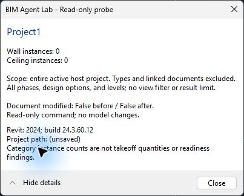
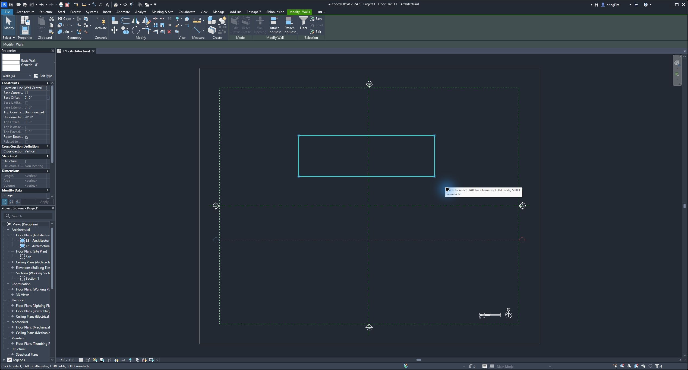
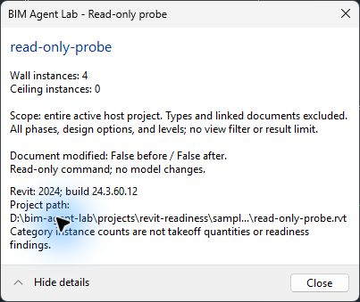
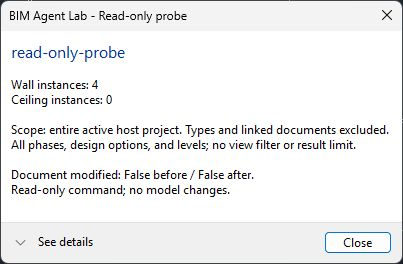
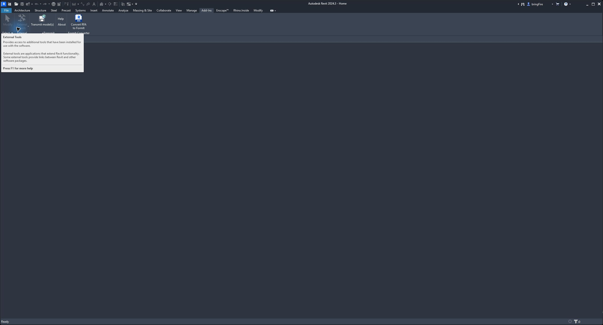

# First read-only probe: verification record

Date: 2026-10-20. Outcome: the command compiled, installed, and ran successfully in **Revit 2024 build 24.3.60.12** on the author's workstation. This verifies the local development setup and the narrow probe behavior below.

Implementation started from teaching-repository commit `88ac2df` on `feat/revit-read-only-probe`. The source, scripts, and this record are committed together. Use that commit's history to identify the exact source revision.

## Machine and dependencies

| Input | Observed |
|---|---|
| OS | Windows 11 Pro x64, build 10.0.26300 |
| Memory | Approximately 63.5 GiB installed |
| Free storage at inspection | Approximately 895.7 GiB on C:, 2529.1 GiB on D: |
| Git | 2.53.0.windows.2 |
| Installed .NET SDKs | 9.0.318; 10.0.204 |
| Selected build SDK | 10.0.204, project `global.json` |
| Add-in target | x64, .NET Framework 4.8 (`net48`) |
| Revit.exe / RevitAPI.dll / RevitAPIUI.dll | All file version 24.3.60.12 |
| Framework references | Installed v4.8 mscorlib, System, System.Core; file version 4.8.3761.0 |
| NuGet packages | Zero libraries in the generated project.assets.json |
| New prerequisite installations | None; all required inputs were already present |

The [machine report](environment.json) contains paths and versions. This is an observed workstation configuration, not a certification of every operating-system build or Revit release. Existing Autodesk, Enscape, and Rhino.Inside add-ins remained installed; the probe has no dependency on them.

The matching installed Revit XML API documentation was inspected for `TransactionMode.ReadOnly`, `FilteredElementCollector`, `GetElementCount`, `Document.IsModified`, task dialogs, and command availability. The [prerequisites guide](../development-prerequisites.md) links official Autodesk and Microsoft documentation. No source from a precedent repository was copied into this implementation.

## Build and registration

Commands run from the repository root:

```powershell
& .\projects\revit-readiness\scripts\Check-Environment.ps1
& .\projects\revit-readiness\scripts\Build-Probe.ps1
# With Revit closed:
& .\projects\revit-readiness\scripts\Install-Probe.ps1
```

The Release build passed with **0 warnings and 0 errors**. A final incremental build also passed; its [captured output](build-output.txt) is retained. Autodesk API DLLs were absent from the output, as intended. The add-in DLL was 6,656 bytes. Its SHA-256 matched the installed copy:

```text
89276450DF13175638DF32D87C3065A41F3CFA065D5647B9111FEB16C4DDF3B9
```

The per-user installer created `BimAgentLab.ReadOnlyProbe.addin` and `BimAgentLab.ReadOnlyProbe/BimAgentLab.RevitProbe.dll` under `%APPDATA%/Autodesk/Revit/Addins/2024/`. Revit's journal recorded successful registration of `BimAgentLab.RevitProbe.ReadOnlyProbeCommand`, assembly version `0.1.0.0`, and three subsequent command invocations. No prerequisite installer or application update ran.

Two failure checks also behaved as expected: an invalid Revit installation path made `Check-Environment.ps1` exit nonzero with missing-input information, and `Install-Probe.ps1` refused to update while Revit was running.

## Host acceptance

The [acceptance procedure](../../tests/read-only-probe.md) preceded implementation. The [fixture recipe](../../samples/model-recipes/read-only-probe.md) makes the model reproducible.

| Check | Expected | Observed |
|---|---|---|
| Fresh Imperial Multi-discipline project | 0 walls; 0 ceilings | 0 / 0; modified False / False |
| Independent Revit selection | Four wall segments | Properties showed Walls (4) |
| Saved four-wall fixture, first read | 4 walls; 0 ceilings | 4 / 0; modified False / False |
| Same saved fixture, repeated read | Identical result | 4 / 0; modified False / False |
| No active project after closing fixture | Command unavailable | External Tools disabled; no save prompt on close |
| RVT bytes before/after reads and after closing | Same SHA-256 | Identical hash at all three checkpoints |

The model was saved at `D:\bim-agent-lab\projects\revit-readiness\samples\local\read-only-probe.rvt`. Its SHA-256 at all three checkpoints was:

```text
7A41FB2AC4169BE2FC099C656FA25A2BD0F8C3E0A934C01EE6F33352F5FFBFB0
```

Normal hashing initially failed because Revit held the file open. A read-only stream with `FileShare.ReadWrite` allowed the two open-file measurements; `Get-FileHash` after closing confirmed the same value. No save was performed between the baseline and these reads. The file hash establishes unchanged saved bytes; the modified-state checks and read-only API execution mode address in-memory changes.

## Retained screenshots

Fresh empty project:



Independent selection count (Properties palette, upper left):



First saved-model result, with details expanded:



Repeated result:



No active project:



Screenshot validation caught JPEG data initially saved with `.png` filenames. The filenames were corrected to `.jpg` without modifying the image bytes.

## Limits and lessons

Repository checks passed: 197 relative links across 49 Markdown/HTML documents resolved, all three PowerShell scripts parsed, project/manifest XML and SDK JSON parsed, and all five screenshots matched their JPEG encoding. Generated output and working model paths were confirmed ignored by Git. The final build DLL still matched the host-tested installed DLL.

The command counts non-type elements in the Walls and Ceilings categories across the active host document. It does not traverse links or apply phase, design-option, level, view, or selection filters. It reports no quantities, readiness findings, exports, or MCP tools. It opens no transaction and makes no model changes.

Only this Revit build and these small controlled cases have been exercised. Nonzero ceilings, family-editor availability, linked/complex models, design options, worksharing, and other releases remain untested. The planned 16-element readiness fixture and Autodesk sample investigation are separate work.

The strongest lesson is the chain of evidence: **installed inputs → successful compile → matching installed DLL → observed host result → independent expected answer → repeatability and unchanged model**. Do not collapse these into a single “it works” claim. Keep prerequisite installation conditional on actual gaps and distinguish a setup proof from the finished BIM tool.
